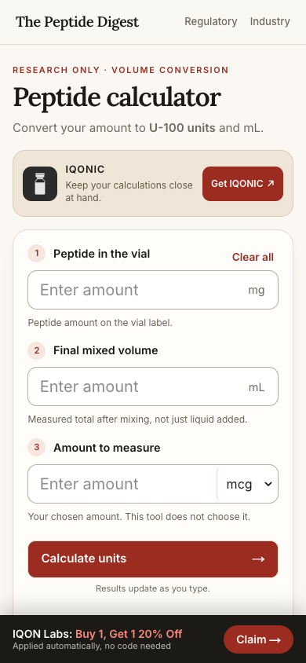
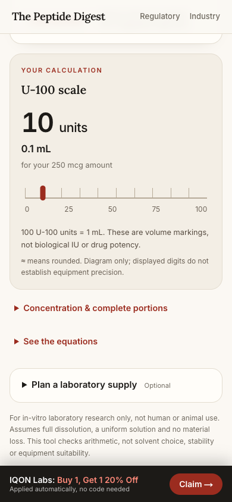
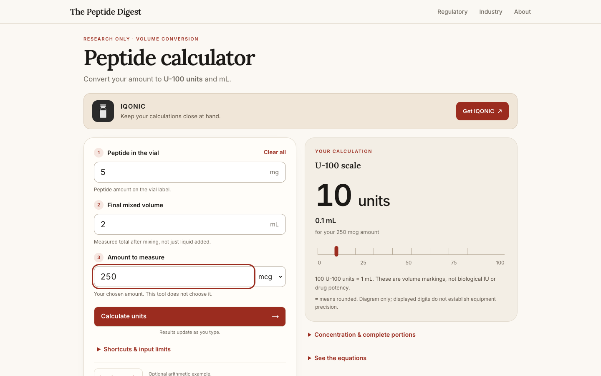
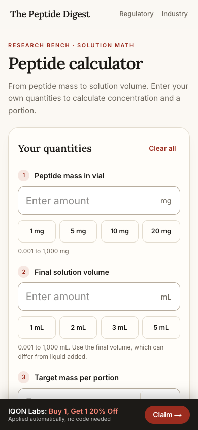

# Calculator clarity preview QA — 2026-11-08

Preview only. Three user-entered quantities now produce a prominent exact-operand U-100 conversion with mL secondary. The same IQONIC tracked banner appears above the inputs. No recommended amounts, production changes, migrations, new tracking providers, or editorial rewrites.

On 360/390/430 × 844, the first input begins at 344.78px and the Calculate button ends at 735.53px (above the sticky offer at 783px). The complete app CTA is at 211.61–255.61px. Desktop 1440×900 has a two-column input/result layout. Actual bounds are in `clarity-results.json`.

## Verification

- `npm test`: 102 passing tests, including 400 independent rational-oracle fixtures inside one test.
- `npm run test:peptide-math`: original 49 passing math tests.
- `BASE_URL=http://127.0.0.1:4876 npm run test:calculator:browser`: 567 passing assertions, collapsed and expanded keyboard paths.
- `BASE_URL=http://127.0.0.1:4876 npm run test:clarity:browser`: 86 passing assertions.
- `BASE_URL=http://127.0.0.1:4876 npm run test:iqonic:browser`: 91 passing assertions.
- `npm run typecheck`, `npm run lint`, `npm run build`, `git diff --check`: pass.

All browser QA intercepted external requests and used a dead local proxy to prevent live analytics or AppsFlyer traffic. Tests run against the real production build. No asset substitutions.

Precision: U-100 output is calculated from full exact operands; exact comparisons control the below-1 and above-100 states. There is no marker for either state. Six-significant-figure approximations carry ≈. The tiny 1000mg/0.001mL/0.001mcg fixture is 1e-10 units. Unit toggles preserve decimal digits; invalid edits immediately clear output.

The full article, references, schema/canonical renderer, shop offers/sticky bar, attribution helper, navigation, and global styles remain unchanged. Original concentration, µL, complete portions, equations, optional example, shortcuts and supply planning remain available.

## Screenshots

Phone initial viewport:

Phone result after Calculate:

Desktop completed calculator:

Before:

## Limits and handoff

Local preview: http://127.0.0.1:4876/peptide-calculator. Additional viewport/error/accessibility captures and complete command logs are in `/Users/edorfanini/.hermes/workspace/iqon-google-ads/calculator-clarity-20261108`.

Desktop 200% browser-zoom equivalent (720×450 CSS pixels, device scale 2) passes reflow and result visibility. An additional root-font-size 200% stress test at 390px passes calculator containment but exposes pre-existing shared navigation/footer overflow; these shared surfaces are unchanged. This extra stress test is distinct from browser zoom. Screenshots record the limitation.

Independent two-reviewer final-head scoring and owner preview approval are parent-owned and pending. This is not a release approval. Vercel previews may require sign-in under existing project protection; no protection or bypass settings are changed. Real install/provider ingestion is outside this synthetic click verification. Rollback before merge: close the PR and stop only the owned preview PID recorded in the external RESULT.md. Production remains unchanged.
